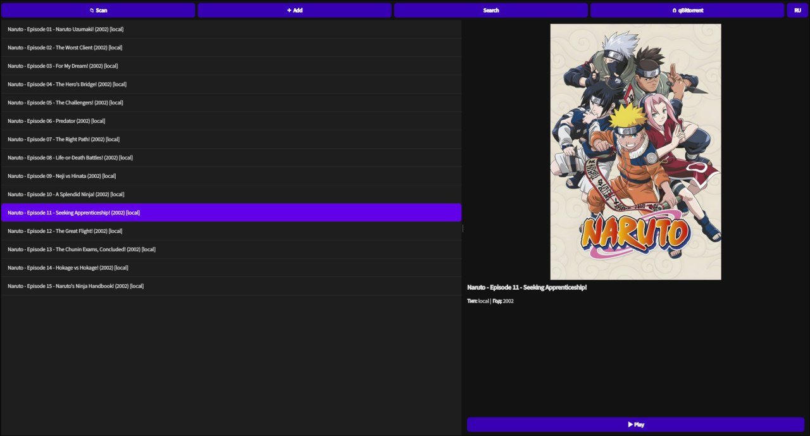

# CineTrack

**CineTrack** is a local desktop media-library manager built with Python and PyQt5. It scans folders for video files, cleans filenames, lets users search TMDB for movie/series metadata and posters, and stores library metadata in SQLite.



## Features

- Recursive scan of `.mkv`, `.mp4`, `.avi`, and `.webm` files.
- TMDB search for movie and TV metadata and poster downloads.
- Local poster lookup and cached remote posters.
- Optional qBittorrent Web API integration.
- Custom dark PyQt5 interface, additional dialogs, and RU/EN language switch.
- CSV export of the local library.
- SQLite storage with titles, genres, title-genre relations, and reviews.
- Keyring-backed storage for API keys and qBittorrent credentials.
- Application settings can be edited after the first launch.

## Architecture

```text
main.py
  ├── config.py                  settings, paths and Keyring
  ├── database/
  │   ├── db.py                  SQLite connection and schema
  │   └── crud.py                parameterized CRUD operations
  └── gui/
      ├── mainwindow.py         main application window
      ├── dialogs.py            setup, search and input dialogs
      ├── workers.py            background scan and network tasks
      └── constants.py          RU/EN interface strings
```

Slow operations (folder scanning, TMDB search/poster download, and qBittorrent requests) run in Qt's thread pool so the interface can continue processing events. Database writes performed by folder scanning are batched in a transaction.

## Requirements

- Python 3.10+
- Packages listed in `requirements.txt`
- A running system credential manager for Keyring (Secret Service/KWallet on Linux, Windows Credential Manager on Windows, or Keychain on macOS)
- Optional: qBittorrent Web UI enabled for the qBittorrent integration
- Optional: a TMDB API key for remote metadata and posters

## Run from source

### Windows

```powershell
py -m venv .venv
.venv\Scripts\activate
py -m pip install -r requirements.txt
py main.py
```

### Linux

```bash
python3 -m venv .venv
source .venv/bin/activate
python -m pip install -r requirements.txt
python main.py
```

MPV is used for playback on Linux when available; otherwise CineTrack falls back to `xdg-open`. For a desktop launcher, run `chmod +x install.sh && ./install.sh` after preparing the Python environment. On NixOS, the launcher uses `shell.nix` when `/etc/NIXOS` and `nix-shell` are present.

### macOS

The source can be launched with a Python 3.10+ virtual environment using the commands above. macOS packaging and end-to-end testing are not currently provided. Video playback uses the system `open` command.

## TMDB API key and secrets

The Setup Wizard accepts a TMDB API key. Secrets are stored with Python `keyring` in the operating system's credential manager. In a source checkout only, `config.py` can also read `TMDB_API_KEY` from an ignored `.env` file; `.env.example` is a template and contains no real credentials. Do not commit `.env` or real API keys.

The local library works without TMDB. Without an API key or network access, remote search and poster downloads are unavailable, while local scanning, SQLite storage, playback, and CSV export remain available.

## Download

Windows users can download the latest prebuilt installer from [GitHub Releases](https://github.com/dispine88/cine-track/releases).

## Build the Windows installer (maintainers)

This section is for developers who want to build the installer from source.

Build Windows binaries on Windows. PyInstaller is not a cross-compiler.

1. Install Python 3.10+ and Inno Setup.
2. Run `build.bat`. It installs the runtime and build dependencies and creates `dist\\CineTrack`.
3. Open `installer.iss` in Inno Setup and compile it (F9). The setup executable is written to the configured output directory.

The PyInstaller build currently uses `onedir`; Inno Setup packages that directory into a Windows installer. `requirements.txt` is for running CineTrack, while `requirements-build.txt` adds PyInstaller for maintainers who create the installer.

## Tests

Run the SQLite tests from the project directory:

```bash
python -m unittest discover -s tests -v
```

GUI and network integration tests must also be performed on a machine with the project dependencies installed and the relevant services available.

## License

MIT License. See [LICENSE](LICENSE).
